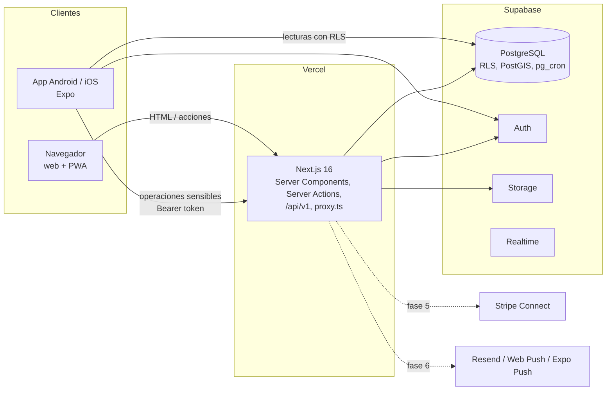

# Arquitectura

## Visión general

## Capas

| Capa | Dónde | Regla |
|---|---|---|
| Dominio | `packages/core/src` | TypeScript puro (sin Next, React Native ni Supabase; lo vigila ESLint). Dinero en céntimos, comisiones, máquinas de estado, validación Zod, filtros de búsqueda, detección de datos de contacto, moderación por términos, textos i18n. Cobertura 100 % de líneas |
| Datos y seguridad | `supabase/migrations` | RLS en todas las tablas (test que lo exige). Transiciones de estado validadas también en SQL. Tablas de eventos/auditoría inmutables |
| Servicios de servidor | `apps/web/src/server/services` | Toda operación sensible. Reciben un `Ctx { user, supabase }` → sirven a la vez a Server Actions (web) y a `/api/v1` (app) |
| Entrega web | `apps/web/src/app` | Server Components por defecto; cliente solo para interactividad |
| Entrega móvil | `apps/mobile/src/app` | Expo Router, pestañas nativas; lecturas directas a Supabase con RLS |

## Flujos principales

### Publicar un anuncio
1. El asistente guarda el borrador automáticamente en `listing_drafts` (RLS: solo la persona autora).
2. Las fotos se suben al servidor, que comprueba el tipo real, **elimina EXIF/GPS** y recomprime a WebP.
3. Al enviar, el servidor valida con Zod (`listingSubmitSchema`), comprueba la categoría, las verificaciones exigidas y los campos propios, y aplica la moderación automática (`blocked_terms`, detección de contacto).
4. Crea el anuncio como borrador **con la sesión de la persona** (RLS) y lo publica o lo manda a revisión **con la clave de servicio** (la persona no puede publicar directamente: lo impiden el trigger y la tabla de transiciones).
5. Registra auditoría e invalida la caché del catálogo.

### Buscar
`public.search_listings(...)`: texto completo en castellano (`tsvector` + `unaccent`) con tolerancia a errores (`pg_trgm`), distancia con PostGIS sobre la ubicación **aproximada** (cuadrícula de ~1 km), filtros y orden en una sola consulta (sin N+1). Los filtros viajan en la URL con nombres en castellano y se validan con `parseSearchParams` (una URL manipulada nunca rompe la página).

### Autenticación
Supabase Auth con cookies `HttpOnly` en la web (`@supabase/ssr`, refresco en `proxy.ts`) y almacenamiento seguro en la app. Confirmación de correo obligatoria. Mensajes idénticos exista o no la cuenta. Límite de intentos (solo cuentan los fallidos).

## Rutas

### Web (`/` = castellano; `/ca/…` y `/en/…`)
| Ruta | Estado |
|---|---|
| `/`, `/explorar`, `/categorias`, `/categorias/[slug]`, `/anuncios/[slug]`, `/personas/[usuario]` | ✅ |
| `/como-funciona`, `/ofrecer-ayuda`, `/seguridad`, `/legal/[doc]` | ✅ |
| `/entrar`, `/registro`, `/recuperar`, `/restablecer`, `/auth/callback` | ✅ |
| `/publicar`, `/cuenta` | ✅ |
| `/mensajes`, `/reservas/[id]`, `/notificaciones`, `/admin` | Fases 4–6 |
| `/api/health`, `/api/v1/drafts/[id]/images`, `/api/v1/drafts/[id]/submit` | ✅ |

### App
Pestañas: Inicio · Explorar · Publicar · Cuenta. Pilas: `anuncio/[slug]`, `entrar`, `registro`, `recuperar`.

## Decisiones
Ver `docs/adr/` (monorepo web+móvil, pagos y normas de las tiendas, API para la app, ubicación aproximada, Cache Components, componentes UI, borradores, eliminación de cuenta).
