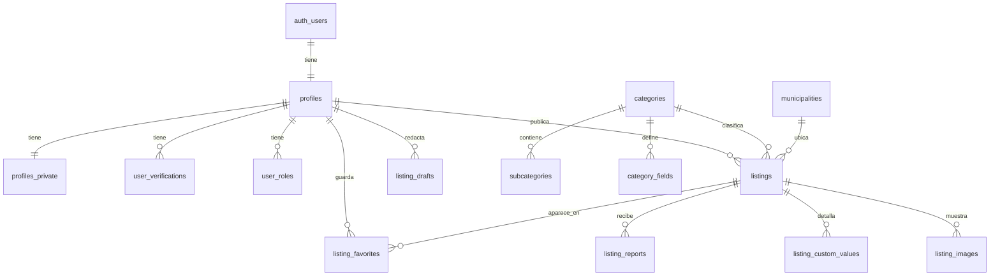

# Base de datos

PostgreSQL 17 (Supabase) con PostGIS, `pg_trgm`, `unaccent`, `pgcrypto` y `pg_cron`. Todo cambio va en una migración (`supabase/migrations`); nunca se edita producción a mano.

## Reglas generales
- RLS activado en **todas** las tablas de `public` (`supabase/tests/01_rls_enabled.test.sql` falla si alguna no lo tiene).
- Dinero en `bigint` (céntimos) + `currency char(3)`.
- Fechas `timestamptz` en UTC; se muestran en `Europe/Madrid`.
- Textos traducibles en `jsonb` `{ "es", "ca", "en" }` (validado con `private.is_valid_i18n`).
- Esquema `private` para utilidades internas: no se expone por la API.
- Los clientes solo pueden **editar columnas concretas** (`grant update (…)`), además de las políticas RLS.

## Tablas actuales

| Tabla | Finalidad | Acceso desde clientes (RLS) |
|---|---|---|
| `municipalities` | Municipios y centroide aproximado | Lectura pública |
| `profiles` | Perfil público, insignias y métricas agregadas | Lectura pública si la cuenta está activa; la persona edita solo nombre, foto, bio, municipio, idiomas y tipo |
| `profiles_private` | Nombre legal, teléfono, CP, preferencias | Solo la propia persona |
| `user_roles` | Moderación / administración | Ver los propios; escribir solo el servidor |
| `user_verifications` | Correo, teléfono, identidad, profesional, documentos (independientes) | Ver las propias; escribir solo el servidor. Un trigger sincroniza las insignias |
| `user_blocks` | Bloqueos entre personas | Gestionar los propios. Un bloqueo oculta los anuncios de quien bloquea |
| `legal_documents` / `legal_acceptances` | Textos versionados y aceptaciones | Lectura pública / ver las propias; no se modifican |
| `categories`, `subcategories`, `category_fields` | Catálogo y campos personalizados | Lectura pública; escritura solo servidor |
| `listings` | Anuncios | Públicos si están en estado visible; los propios siempre. Insertar solo como borrador; cambios de estado limitados por `private.listing_transitions` |
| `listing_drafts` | Borradores del asistente | Solo la persona autora (máx. 20) |
| `listing_images` | Fotos (ya sin metadatos) | Lectura si el anuncio es visible; escritura solo servidor |
| `listing_custom_values` | Valores de campos personalizados | Públicos si el campo lo es |
| `listing_favorites` | Favoritos | Solo los propios |
| `listing_reports` | Denuncias | Crear con sesión; leer moderación (y quien denunció) |
| `listing_views_daily` | Visitas agregadas por día, sin IP | Autor y moderación |
| `blocked_terms` | Términos que envían a revisión o rechazan | Solo servidor |
| `account_deletion_requests` | Solicitudes de baja (14 días de gracia) | Ver la propia; RPC para pedir/cancelar |
| `audit_logs` | Auditoría inmutable (sin FK: sobrevive a las bajas) | Solo administración la lee; nadie la modifica |
| `feature_flags`, `platform_settings` | Configuración | Lectura pública de lo marcado como público |

Tablas de fases futuras (conversaciones, propuestas, reservas, pagos, incidencias, valoraciones, notificaciones…) están definidas en `docs/PRODUCT_SPEC.md` §24.

## Funciones expuestas
| Función | Uso |
|---|---|
| `search_listings(...)` | Búsqueda con filtros, distancia aproximada y orden |
| `category_listing_counts()` | Anuncios publicados por categoría |
| `platform_stats()` | Indicadores de la portada (se ocultan bajo un umbral) |
| `record_listing_view(id)` | Solo servidor |
| `has_staff_role(role)` | Comprobación de rol en políticas |
| `request_account_deletion()` / `cancel_account_deletion()` | Baja de cuenta |

## Tareas programadas (`pg_cron`)
| Tarea | Horario |
|---|---|
| `private.process_account_deletions()` | Diaria, 03:17 UTC |

## Diagrama (núcleo actual)

## Pruebas (pgTAP)
`pnpm db:test` — 41 pruebas: RLS en todas las tablas, perfiles (privacidad, columnas protegidas), anuncios (transiciones, suplantación, contadores, borradores ocultos), auditoría inmutable, roles, publicación desde el servidor, baja de cuenta completa.
